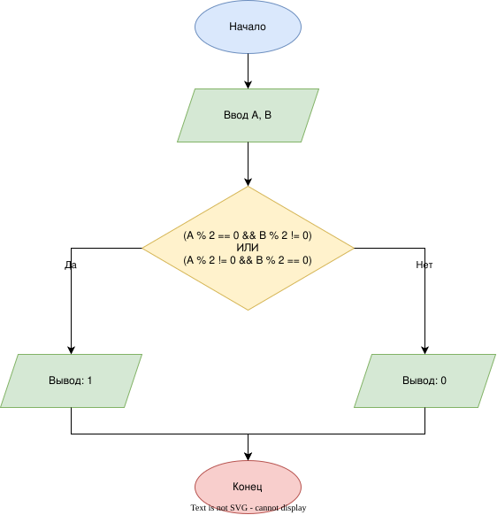

# Домашняя работа

## Условие задачи
Программа определяет, какая из двух команд (А или В) получает право первого хода. Согласно условию, право первого хода получает та команда, для которой выполняется правило: **только один из выпавших номеров является четным**.

## Ход работы
1. Программа запрашивает у пользователя ввод двух целых чисел (номера команд А и В).                                                                                                                                                                                                        
2. С помощью оператора остатка от деления `%` вычисляется четность каждого числа.
3. Формируется сложное логическое условие:
   `(A % 2 == 0 && B % 2 != 0) || (A % 2 != 0 && B % 2 == 0)`
   *   Первая часть условия проверяет, что число А — четное, а В — нечетное.
   *   Вторая часть (после `||`) проверяет обратную ситуацию: А — нечетное, В — четное.
4. Результат логического выражения (1 — истина, 0 — ложь) сохраняется в переменную `С`.
5. Программа выводит результат на экран.
### Блок-схема

